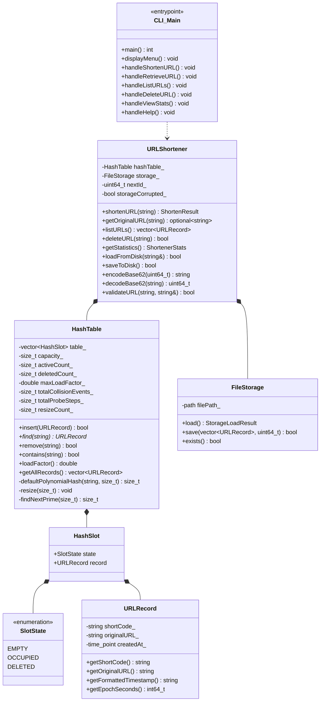

# HashLink CLI — C++17 URL Shortener Using Custom Hash Tables

[](https://en.wikipedia.org/wiki/C%2B%2B17)
[-brightgreen.svg)]()
[](LICENSE)

HashLink CLI is an educational, production-quality, terminal-based URL shortener and manager developed in modern **C++17**.

The application is built for university **Advanced Data Structures and Algorithms (ADSA)** courses and public GitHub portfolios. It implements a **custom Open-Addressing Hash Table from scratch**, featuring **Polynomial Rolling Hashing**, **Linear Probing**, **Tombstone-based Deletions**, **Dynamic Prime-Sized Rehashing**, and **Deterministic Base62 Encoding**.

> [!IMPORTANT]
> **Local Application Notice:** HashLink CLI stores and retrieves URL records locally via persistent file storage. It is designed to demonstrate Data Structures & Algorithms and does not run a public HTTP redirect web server.

---

## Architecture Diagram



---

## Key Features

* **Custom Open-Addressing Hash Table:** No `std::unordered_map` or `std::map`. Memory is managed in a contiguous array of slots.
* **Polynomial Rolling Hash:** Evaluated in $O(k)$ time via Horner's rule with prime base $p = 53$.
* **Linear Probing:** Sequential open addressing that maximizes CPU cache line hits.
* **Tombstone Lifecycle Management:** Slots marked `DELETED` prevent search chains from breaking while allowing reuse during future insertions.
* **Deterministic Base62 Generator:** Monotonically increasing 64-bit counter converted to `[0-9a-zA-Z]` without random number collisions.
* **Non-reusable IDs:** Deleting a short code preserves the monotonic counter, ensuring old URLs are never erroneously remmapped.
* **Atomic File Persistence:** Serializes active records and monotonic state using `std::quoted` to safely handle spaces and special characters. Employs atomic rename (`.tmp` $\to$ target) to prevent database corruption.
* **Real-Time Telemetry:** Tracks load factor, active records, tombstone count, cumulative collision events, and probe iterations.
* **Automated Unit Testing:** 13 repeatable tests covering forced collisions, tombstone traversal, dynamic resizing, corruption handling, and edge cases.

---

## Data Structures & Algorithms Concepts Demonstrated

### 1. Polynomial Rolling Hashing
Keys are hashed using the polynomial summation:
$$H(S) = \left( \sum_{i=0}^{k-1} s_i \cdot 53^{k-1-i} \right) \pmod{\text{capacity}}$$
Computed iteratively via **Horner's rule** to prevent arithmetic overflow:
```cpp
size_t hashVal = 0;
for (unsigned char c : key) {
    hashVal = (hashVal * 53 + c) % capacity;
}
```

### 2. Linear Probing with Tombstones
When a collision occurs at index $h$, the table probes $(h + 1) \pmod M$, $(h + 2) \pmod M$, and so on.
* If a record is deleted, setting its slot to `EMPTY` would break subsequent lookups for records hashed to the same bucket.
* Instead, the slot is tagged `DELETED` (a **tombstone**). Searches continue through tombstones, and subsequent insertions reuse them.

### 3. Prime Capacity Growth & Rehashing
When the load factor $\alpha = \frac{N}{M} > 0.70$, the capacity expands to the next prime number $\ge 2M$. Rehashing copies active records and purges all tombstones, resetting probe chains to optimal length.

---

## Complexity Analysis

| Operation | Average Case | Worst Case | Space Complexity | Explanation |
| :--- | :---: | :---: | :---: | :--- |
| **Search by Short Code** | $O(1)$ | $O(N)$ | $O(1)$ | Instant lookup; degrades to $O(N)$ only under pathological clustering. |
| **Insert New Record** | $O(1)$ amortized | $O(N)$ | $O(1)$ | Constant time unless table triggers prime rehashing. |
| **Delete (Tombstone)** | $O(1)$ | $O(N)$ | $O(1)$ | Marks slot state to `DELETED`. |
| **Duplicate URL Check** | $O(N)$ | $O(N)$ | $O(1)$ | Linear scan through active records. |
| **Base62 Encode/Decode** | $O(\log_{62} \text{ID})$ | $O(\log_{62} \text{ID})$ | $O(1)$ | Position-based radix conversion. |

---

## Repository Structure

```
.
├── CMakeLists.txt              # CMake build configuration
├── README.md                   # Project overview & documentation
├── LICENSE                     # MIT License
├── .gitignore                  # Git ignore rules
├── include/
│   ├── URLRecord.h             # Record encapsulation header
│   ├── HashTable.h             # Custom Open-Addressing Hash Table header
│   ├── URLShortener.h          # Application business logic header
│   └── FileStorage.h           # File persistence header
├── src/
│   ├── main.cpp                # Terminal interactive menu interface
│   ├── URLRecord.cpp           # URLRecord implementation
│   ├── HashTable.cpp           # HashTable implementation
│   ├── URLShortener.cpp        # URLShortener implementation
│   └── FileStorage.cpp         # FileStorage implementation
├── tests/
│   ├── test_hash_table.cpp     # Unit tests for Hash Table & tombstones
│   └── test_url_shortener.cpp  # Unit tests for URL Shortener & storage
├── docs/
│   ├── algorithms.md           # Theoretical deep-dive into ADSA concepts
│   └── viva_questions.md       # Practical exam & viva interview Q&A
└── data/
    └── .gitkeep                # Default persistent database directory
```

---

## Build and Installation Instructions

### Prerequisites
* A C++17 compliant compiler: `GCC 9+` or `Clang 10+`
* `CMake 3.16+`
* Linux, macOS, or Windows (WSL / MinGW)

### Build with CMake (Recommended)
```bash
# 1. Clone the repository
git clone <repository-url>
cd mini-project

# 2. Configure build files
cmake -S . -B build

# 3. Compile the application and test suites
cmake --build build

# 4. Run automated unit tests
ctest --test-dir build --output-on-failure

# 5. Launch the application
./build/hashlink
```

### Direct GCC Compilation Command
If you wish to compile directly without CMake:
```bash
g++ -std=c++17 -Wall -Wextra -Wpedantic -Iinclude \
    src/URLRecord.cpp src/HashTable.cpp src/URLShortener.cpp src/FileStorage.cpp src/main.cpp \
    -o hashlink

./hashlink
```

---

## Running Automated Tests

HashLink CLI includes 13 self-contained, deterministic tests.

```bash
# Run via CTest
ctest --test-dir build --output-on-failure

# Or run individual test runners directly:
./build/test_hash_table
./build/test_url_shortener
```

### Test Coverage Highlights
* Empty table behavior and boundary checks.
* Key insertion, retrieval, and duplicate key rejection.
* Forced hash collisions using injected constant hash functions.
* Linear probe chain navigation across tombstone slots.
* Dynamic resizing and rehashing to prime capacities without data loss.
* Deterministic Base62 encoding and decoding edge cases.
* Basic URL validation (HTTP/HTTPS, whitespace rejection, host presence).
* Linear duplicate original URL detection.
* ID monotonicity: verifying `nextId` is never decremented when the highest ID is deleted.
* Persistent file round-trip across independent application instances.
* Protection against corrupted or malformed database files.

---

## Database Location & Persistence

* **Default Location:** `data/hashlink.db`
* **Custom Location:** Pass the desired database path as a command-line argument:
  ```bash
  ./build/hashlink /custom/path/my_records.db
  ```
* **Backup:** Simply copy the database file:
  ```bash
  cp data/hashlink.db data/hashlink_backup.db
  ```
* **Format:** Plain text format using `std::quoted` escaping:
  ```
  # HASHLINK_STORAGE_V1 next_id=3
  # short_code quoted_url epoch_seconds
  1 "https://github.com" 1793299602
  2 "https://en.wikipedia.org" 1793299615
  ```

---

## Sample Interactive Terminal Session

```
======================================================
      HashLink CLI - C++17 URL Shortener             
   Advanced Data Structures & Algorithms Project      
======================================================
Successfully loaded 2 record(s) from data/hashlink.db

+----------------------------------------------------+
|             HASHLINK CLI - MAIN MENU               |
+----------------------------------------------------+
| 1. Shorten a URL                                   |
| 2. Retrieve Original URL by Short Code             |
| 3. List All Saved URLs                             |
| 4. Delete a Shortened URL                          |
| 5. View Hash Table & System Statistics             |
| 6. Help & ADSA Algorithm Guide                     |
| 7. Save & Exit                                     |
+----------------------------------------------------+
Select an option (1-7): 5

======================================================
  DATA STRUCTURES & ALGORITHMS (ADSA) METRICS
======================================================
Hash Table Capacity          : 11 slots
Active Records               : 2
Tombstone (Deleted) Slots    : 0
Current Load Factor (alpha)  : 0.1818 (Threshold: 0.7000)
Dynamic Resize Operations    : 0
Cumulative Collision Events  : 0
Cumulative Probe Steps       : 2
Next Monotonic ID (Base62)   : 3 (Encodes as: 3)
Database File Path           : data/hashlink.db
```

---

## Limitations

* **Local Storage Only:** Short codes do not provide active HTTP 301/302 redirects in a web browser.
* **Single-Process Persistence:** Designed for single-user local CLI access; does not implement distributed multi-process file locking.
* **Duplicate URL Linear Scan:** Uses an $O(N)$ scan to deduplicate original URLs, trading time for reduced memory usage.

---

## Future Improvements

1. **Secondary Hash Index:** Implement a second hash table mapping `OriginalURL -> ShortCode` to achieve $O(1)$ duplicate checking.
2. **Double Hashing or Quadratic Probing:** Add secondary hashing to completely eliminate primary clustering.
3. **Embedded HTTP Daemon:** Optional micro-server (e.g., using `cpp-httplib`) to serve real HTTP redirects over localhost.

---

## License

This project is licensed under the **MIT License** — see the [LICENSE](LICENSE) file for details.
